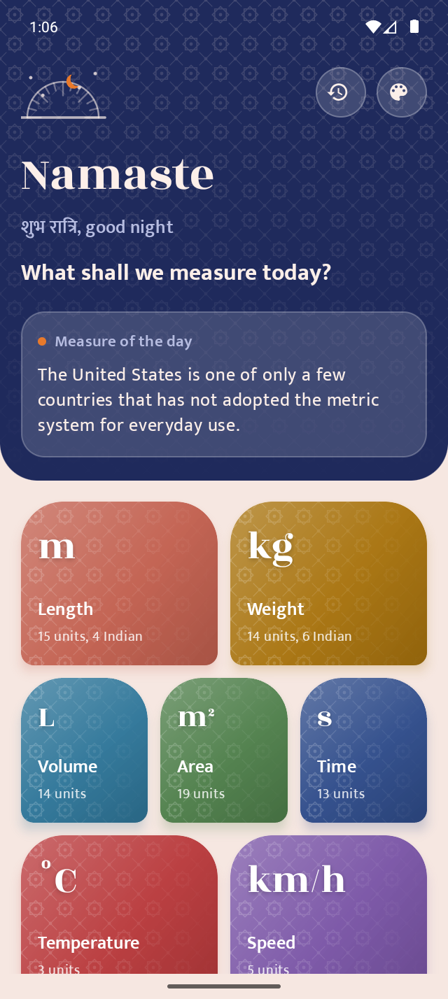
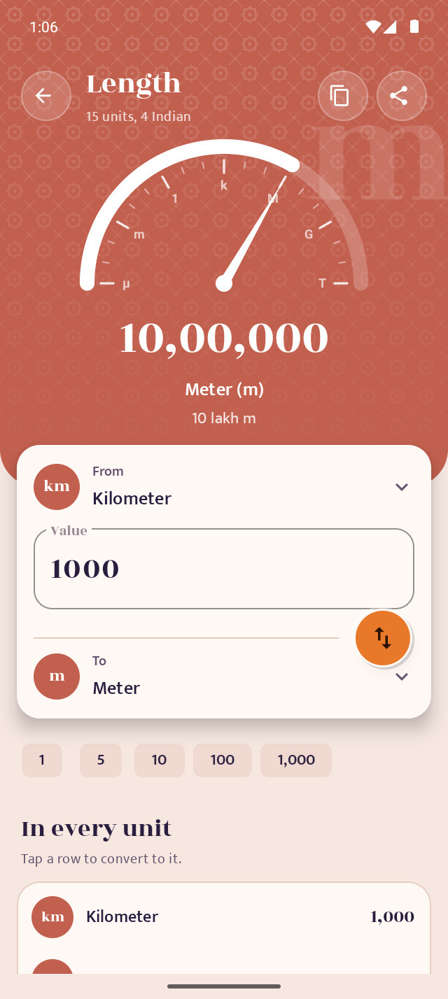
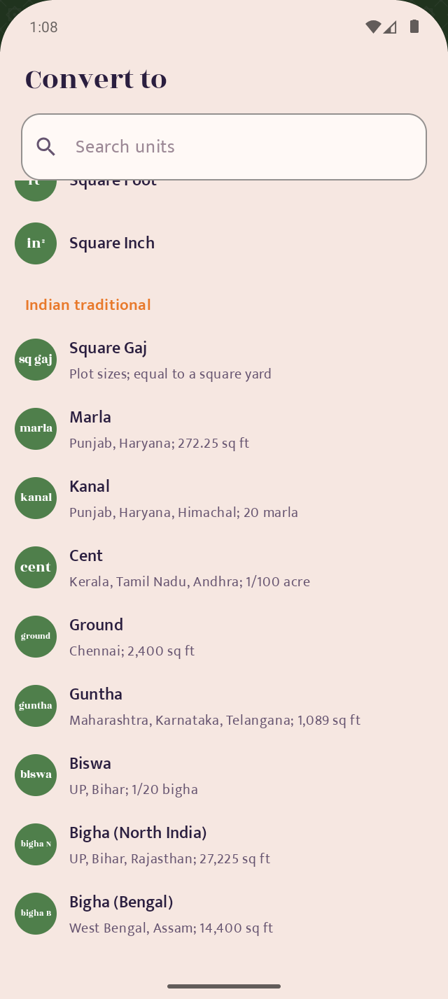
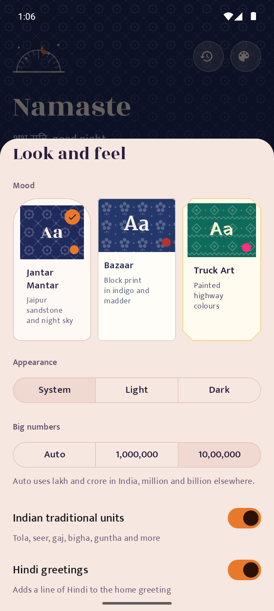
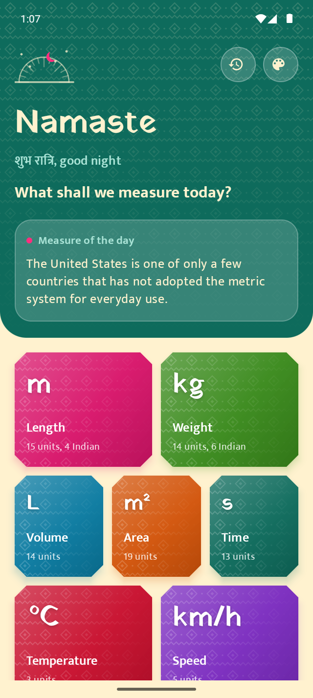
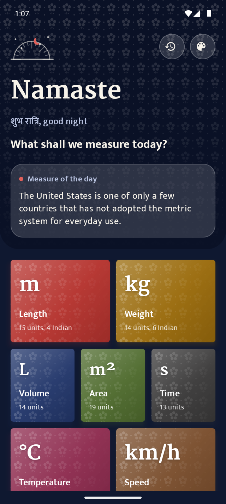
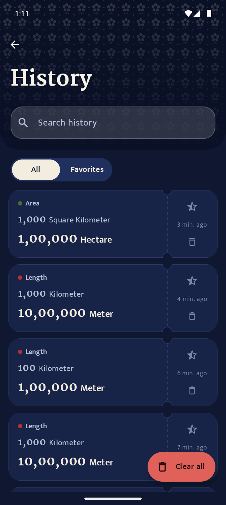

# SmartConvert

An offline unit converter for Android, designed around India's long history of measurement and built for everyone.

Some of the world's earliest standard weights come from Harappan cities, the ivory scale from Lothal is marked in divisions of about 1.7 mm, and Jaipur's Jantar Mantar is a set of giant stone measuring instruments. SmartConvert borrows from that heritage: a real-time sundial on the home screen, a magnitude dial for every result, and three visual moods drawn from Indian craft. It still works the way anyone in the world would expect, with metric, imperial and US units, and numbers formatted for your region.

<p align="center">
  
  
  
</p>

## Features

**Converting**
- 8 categories and 90 units: length, weight, temperature, volume, area, speed, time and digital storage
- Results update as you type; no Convert button
- Magnitude dial: a needle on a µ to T scale shows at a glance whether a value is tiny or huge
- Big numbers in words: "10 lakh m" in India, "1 million m" elsewhere
- Searchable unit picker grouped into Metric, Imperial and US, Indian traditional and Standard
- "In every unit": your value converted to every unit of the category at once; tap a row to switch to it
- Quick values (1, 5, 10, 100, 1,000), a swap button, copy and share

**India and the world**
- 22 Indian traditional units, each with a note on where it is used: tola, ratti, masha, chhatank, seer and maund for weight; gaj, hath, angul and kos for length; square gaj, marla, kanal, cent, ground, guntha, biswa and bigha (North India and Bengal) for land; pal, ghadi and prahar for time
- Lakh and crore grouping (12,50,000) turns on automatically when the phone's region is India; everyone else gets 1,250,000. Either can be chosen in settings
- The home greeting cycles through hellos from around the world and settles on yours, with an optional line of Hindi
- A measurement fact of the day, alternating Indian and world history

**History**
- Every conversion is saved locally (Room) and shown as a railway ticket
- Search, favourites, swipe to delete with undo, and tap to reuse a conversion

## Three moods

The whole app is themed through one set of tokens, so a mood changes colours, display typeface, tile shape and background pattern together. Each mood has a light and a dark version, and switching spreads the new look across the screen from where you tapped.

| Mood | Inspired by | Display face | Pattern | Tiles |
|---|---|---|---|---|
| **Jantar Mantar** (default) | Jaipur's pink sandstone and night sky | Rozha One | jaali star lattice | arch windows |
| **Bazaar** | hand-block printing in indigo and madder | Martel | buti flowers | printing blocks |
| **Truck Art** | painted highway trucks | Yatra One | diamonds and chevrons | cut-corner plaques |

<p align="center">
  
  
  
  
</p>

Body text throughout is set in Mukta by Ek Type (Mumbai), which covers both Latin and Devanagari.

## Privacy

SmartConvert requests no permissions and has no network access. History and settings stay on the device.

## Tech stack

- Java 11, Android SDK 21 to 36 (Android 5.0 and later)
- MVVM with ViewModel and LiveData; Room for history
- Material Components 3 with a custom token-based theme engine
- Custom views drawn on Canvas: sundial, magnitude dial, tiled patterns, railway tickets
- Material container transform between the home tile and the conversion screen
- Android Gradle Plugin 9.5.1, Gradle 9.6.0, R8 for release builds
- JUnit 4 and Mockito: 56 unit tests covering conversions, number formatting (including lakh/crore) and the Indian units

## Project structure

```
app/src/main/java/com/unitconverter/app/
├── MainActivity.java            Home: hero, bento categories, recent tickets
├── ConversionActivity.java      Dial, unit cards, quick values, every-unit list
├── HistoryActivity.java         Search, tabs, ticket list
├── SmartConvertApp.java         Applies saved look and number settings at start
├── data/                        Room database, UnitProvider, repositories
├── domain/model/                Unit, UnitCategory, ConversionResult
├── presentation/
│   ├── adapter/                 Category and recent-conversion adapters
│   ├── sheet/                   Unit picker and look-and-feel bottom sheets
│   ├── viewmodel/               MainViewModel, ConversionViewModel
│   └── widget/                  SundialView, ArcDialView, PatternView, TicketDrawable
├── settings/                    AppSettings, ThemeManager (moods and reveal)
└── util/                        NumberFormatter, Greetings, insets helpers

app/src/main/res/
├── values/attrs.xml             Theme tokens (sc*) used by every screen
├── values/themes.xml            Base theme and the three moods (day)
├── values-night/themes.xml      The three moods (night)
├── values/colors.xml            All six palettes
└── font/                        Mukta, Rozha One, Martel, Yatra One
```

## Building

You need Android Studio (recent stable) or the Android SDK with platform 36, and **JDK 17 or newer** to run Gradle 9.

```bash
# Debug APK (Windows: gradlew.bat)
./gradlew assembleDebug

# Install on a connected device or emulator
./gradlew installDebug

# Unit tests
./gradlew test
```

### Release build

Release builds are signed only if a `keystore.properties` file exists in the project root. Copy `keystore.properties.example`, fill in your upload key details, and keep both the file and the keystore out of version control (they are already git-ignored).

```bash
./gradlew bundleRelease    # app/build/outputs/bundle/release/app-release.aab
./gradlew assembleRelease  # app/build/outputs/apk/release/app-release.apk
```

## Adding a unit

Units live in `data/provider/UnitProvider.java`. Each one has a name, a symbol and a factor that converts it to the category's base unit (metre, kilogram, square metre, litre, second and so on). Tag it with its system so the picker groups it correctly:

```java
areaUnits.add(new Unit("Guntha", "guntha", UnitCategory.AREA, 101.17141056)
        .tag(Unit.MeasureSystem.INDIAN, "Maharashtra, Karnataka, Telangana; 1,089 sq ft"));
```

Temperature units also take an offset; see the Celsius and Fahrenheit entries.

## Credits

Fonts are from Google Fonts under the SIL Open Font License: Mukta (Ek Type), Rozha One (Indian Type Foundry), Martel (Dan Reynolds), Yatra One (Catherine Leigh Schmidt).
